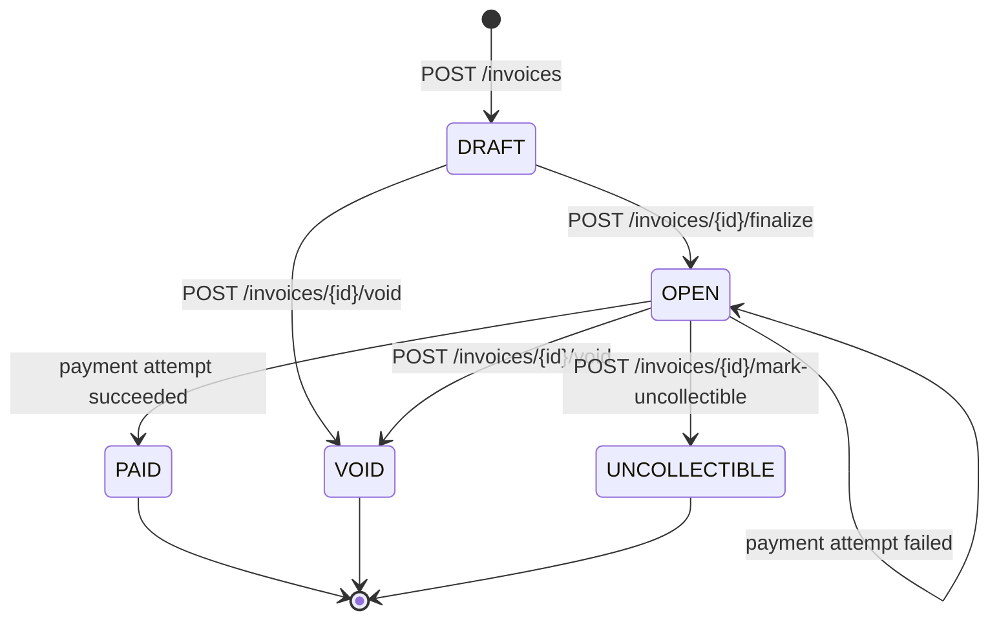

# Design: Invoice & Payment Service

Go (stdlib `net/http`, `pgx`) and PostgreSQL 16. Binaries: `api` (HTTP + webhook worker), `mockpsp`, and `webhook-sink` (demo receiver).

## 1. Data Model

All money is `BIGINT` cents; there is no float in the money path. Every primary key is a **UUIDv7 generated in the app**: time-ordered, so index inserts append (unlike UUIDv4); not guessable and not a volume leak (unlike `BIGSERIAL`); and known before the insert, so it can be logged.

| Table | Shape and indexes | Why this shape | At 100x |
|---|---|---|---|
| `businesses` | `id`, `name` | Tenant root | Unchanged |
| `api_keys` | `business_id`, `prefix`, `key_hash` UNIQUE, `revoked_at` | Own table, so a business can hold several keys and revoke one | Cache hash → business for a few seconds |
| `customers` | `business_id`, `name`, `email`; UNIQUE `(id, business_id)`; index `(business_id, created_at DESC)` | The composite unique is the target of the invoice FK | Cursor pagination |
| `invoices` | `business_id`, `customer_id`, `state` (text + CHECK), `total_cents`, `due_date`; FK `(customer_id, business_id)`; index `(business_id, state, created_at DESC)` | The composite FK makes the database guarantee the customer belongs to the same business. The index serves list-by-state | Partition by time; archive terminal invoices |
| `invoice_line_items` | `invoice_id`, `description`, `quantity`, `unit_amount_cents`, `amount_cents` | Rows rather than JSONB, so amounts are typed and CHECKed | Partition with invoices |
| `payment_attempts` | `invoice_id`, `amount_cents`, `status`, `psp_ref`, `failure_code`; partial unique `(invoice_id) WHERE status='pending'` and `WHERE status='succeeded'` | One row per try is the payment history. The partial indexes make "one in flight, one success" a database invariant | Partition by time |
| `idempotency_keys` | PK `(business_id, key)`, `fingerprint`, `status`, stored response | Scoped per business; stores the full response for replay | TTL and cleanup, or Redis |
| `webhook_endpoints` | `business_id`, `url`, `secret` | Secret is plaintext because we sign with it | Encrypt with a KMS key |
| `events` | `id`, `business_id`, `type`, `payload` | Immutable record; `id` is what receivers dedupe on | Partition by time; retention |
| `webhook_deliveries` | `event_id`, `endpoint_id`, `status`, `attempt_count`, `next_attempt_at`; partial index `(next_attempt_at) WHERE status='pending'` | One row per (event, endpoint), so endpoints retry independently | Replace polling with a queue and dedicated workers |

## 2. Invoice State Machine

- **Terminal:** PAID, VOID, UNCOLLECTIBLE. **No transition is reversible.**
- Only an OPEN invoice can be paid. A failed payment leaves it OPEN so it can be tried again.
- There is no `PROCESSING` invoice state. "A payment is in flight" lives on the payment attempt (`pending`, `succeeded`, `failed`), so the invoice has no state it could get stranded in.
- **Rejecting invalid transitions:** each transition is `UPDATE … WHERE id=$1 AND business_id=$2 AND state = ANY($allowed) RETURNING …`. Zero rows means 404 if the invoice doesn't exist, otherwise **409 `invalid_state_transition`** naming the current state.
- Void and mark-uncollectible return 409 `payment_in_progress` while an attempt is pending. They lock the invoice row first (`SELECT … FOR UPDATE`), then check for the attempt. A single `UPDATE … AND NOT EXISTS (…)` would use a stale snapshot under READ COMMITTED and miss an attempt `/pay` just committed.

## 3. Payment Correctness & Failure Modes

**Mechanism: a status-conditional update plus a partial unique index.** `/pay` runs one short "claim" transaction: `UPDATE invoices … WHERE state='OPEN'` (row lock plus state re-check), then an insert of a `pending` attempt, committed **before** the PSP is called. The PSP call runs in a detached goroutine with a 40 s timeout and writes the result in a second transaction. The handler waits at most 5 s.

Why not the alternatives:
- **`FOR UPDATE` held across the PSP call:** pins a connection and a row lock for up to 30 s.
- **Advisory locks:** die with the connection, leaving no durable record of an in-flight charge.
- **Serializable isolation:** needs retry loops and still cannot cover the PSP call.
- **A version column:** guards the state change, not the number of PSP calls.

**(a) Two simultaneous `/pay` calls.** Both reach the claim. The row lock serialises them; the first inserts the pending attempt, and the second hits the unique index and gets 409 `payment_in_progress` (or 409 `invalid_state_transition` if it arrives after PAID). One PSP call, one charge.

**(b) PSP timeout (`tok_timeout`).** The endpoint returns **202** with the `attempt_id` after 5 s. The attempt is `pending`; the invoice is OPEN but blocked. The background call completes at 30 s and marks the attempt `succeeded` and the invoice PAID. The caller finds out from `GET /invoices/{id}` (which lists attempts) or the `invoice.paid` webhook.

**(c) PSP succeeds, service crashes before persisting.** The pending attempt was committed before the call, so it survives. A retry with the same key gets 409 `idempotency_request_in_progress`; a new key gets 409 `payment_in_progress`. Nothing calls the PSP again, so **no double charge**. The cost: the invoice stays blocked until it is reconciled against the PSP, which is not built (§7).

**(d) Same key, different body.** The key stores `sha256(method + path + body)`. A mismatch returns **422 `idempotency_key_reused`** and nothing runs. Including the path means reusing a key on a different invoice is also caught.

**(e) `/pay` on a PAID invoice.** The claim's `WHERE state='OPEN'` matches nothing: **409 `invalid_state_transition`**, no attempt, no PSP call. The original request's key replays its stored 200.

**PSP errors (`tok_network_error`).** A 5xx or a dropped or refused connection marks the attempt `failed` (`psp_unavailable`); the endpoint returns 502 and the invoice stays OPEN and payable with a new key. Trade-off: with a real PSP, a dropped connection can hide a charge that went through, so releasing could double-charge. The mock cannot produce that case. In production I would send the PSP an idempotency key and confirm with a status lookup before releasing. With **no evidence at all** (a crash, or no answer in 40 s), the invoice stays blocked instead.

## 4. Webhook Design

- **Signing:** HMAC-SHA256 with a per-endpoint secret over `timestamp + "." + raw body`, sent as `Webhook-Signature: v1=<hex>` with `Webhook-Id` and `Webhook-Timestamp`.
- **Replay protection:** the timestamp is inside the signature, so receivers reject anything older than 5 minutes, and they dedupe on the event ID.
- **Decoupling (transactional outbox):** the event row and one delivery row per endpoint are inserted in the **same transaction** as the state change, so an event is never lost to a crash or sent for a rolled-back change. A worker goroutine polls every second with `FOR UPDATE SKIP LOCKED`, leases each delivery for 60 s, and sends outside the transaction. The API never waits for a receiver.
- **Retry policy:** first attempt immediately, then after 10 s, 1 m, 5 m, 30 m, 2 h, 6 h, 12 h and 24 h. That is **9 attempts over about 45 hours**. Success is a 2xx within 10 s.
- **Exhausted budget:** the delivery is marked `dead` and kept with its last status code and error. Nothing retries it.
- **Reconciling missed events:** the API is the source of truth. `GET /invoices?state=…` and `GET /invoices/{id}` return current state and all attempts. Delivery is at-least-once and unordered.

## 5. API Key Model

- **Generation:** `sk_<8-char prefix>_<32+ random chars>` from `crypto/rand`.
- **Storage:** the prefix (to identify a key in logs) plus SHA-256 of the full key. The plaintext is shown once. SHA-256 rather than bcrypt because the key is high-entropy random, so brute force is infeasible and a slow hash would only add latency to every request.
- **Transmission:** `Authorization: Bearer <key>`, over TLS in production.
- **Revocation:** `revoked_at` is checked in the lookup on every request, so it is immediate. There is no endpoint; it is a SQL update today.
- **Rotation:** the schema allows several keys per business: issue a new one, switch over, revoke the old one. Not built.
- **Blast radius if leaked:** one business. The holder gets full API access to it, including registering a webhook endpoint to receive its events. They cannot reach other tenants (every query is scoped by `business_id`), PSP credentials, or card data (only tokens pass through).

## 6. What I Cut and Why

1. **Key rotation and revocation endpoints.** The schema supports them; the endpoints are admin surface the brief doesn't ask for.
2. **PSP idempotency keys, status lookup and a reconciler.** They need the mock extended beyond the given spec, so I kept it to spec and block the invoice when the outcome is unknown.
3. **Webhook replay endpoint.** The invoice API already covers reconciliation.
4. **Reopening UNCOLLECTIBLE** (to PAID or VOID). Terminal is simpler to reason about.
5. **Cursor pagination.** Lists take `limit` only.

Also not built, per the brief: **refunds and partial payments** (a `refunds` table against a succeeded attempt, plus an amount-paid column and a partially-paid state), **rate limiting** (a per-key token bucket returning 429), and idempotency-key expiry.

## 7. Production Readiness Gap

1. **Payment reconciliation.** Orphaned pending attempts block invoices forever, and PSP errors are released without proof. A job that asks the PSP for the outcome fixes both.
2. **Observability.** Metrics and alerts for dead webhook deliveries, stuck attempts and PSP error rate. Today there are only structured logs.
3. **Rate limiting and an audit log.** Nothing throttles a leaked key or records who changed what.
